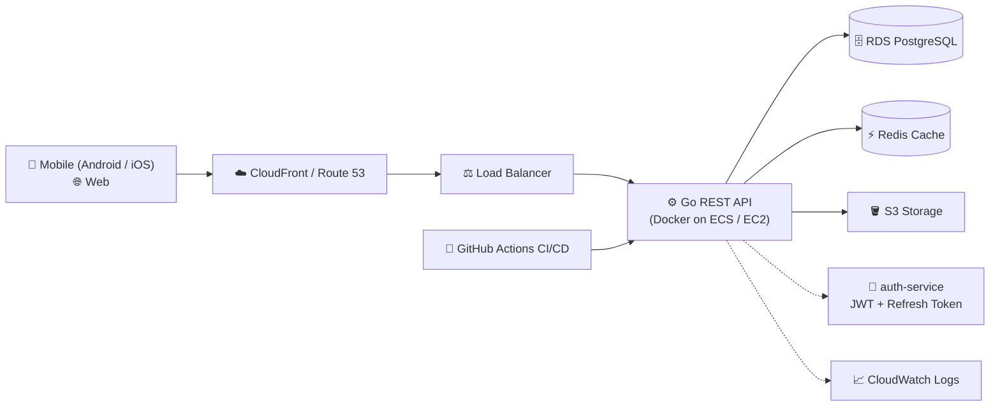

  

---

## 🚀 What I do

- 📱 Build **native and cross-platform mobile apps** for Android and iOS
- ⚙️ Design **backend services and APIs**, including JWT authentication with refresh token rotation
- 🌐 Develop **web applications** end to end, from database to UI
- ☁️ Deploy and run services on **AWS** with Docker and CI/CD

## 🛠 Tech Stack

**💬 Languages**

**📱 Mobile (Android · iOS · Cross-platform)**

**🌐 Frontend**

**⚙️ Backend / Server**

**🗄 Database**

**☁️ AWS / Cloud**

**🧰 DevOps / Infra**

## ☁️ AWS & Cloud

- 🖥 Run services on **EC2 / ECS** behind a load balancer
- 🗃 Store files and static assets on **S3**, serve them through **CloudFront**
- 🗄 Manage databases on **RDS (PostgreSQL)** and cache with **Redis**
- ⚡ Build event-driven tasks with **Lambda** and **API Gateway**
- 🔐 Control access with **IAM** roles and least-privilege policies
- 📈 Monitor logs and metrics with **CloudWatch**

## 🏗 How a typical project of mine flows

## 📌 Featured Projects

| Project | Description | Stack |
|---|---|---|
| [🔐 auth-service](https://github.com/kit-chu/auth-service) | Standalone JWT auth service with login and refresh token rotation | Go |
| [⚙️ flowbot-api](https://github.com/kit-chu/flowbot-api) | Backend API for Flowbot | Go |
| [🌐 flowbot-web](https://github.com/kit-chu/flowbot-web) | Web frontend for Flowbot | TypeScript |
| [🥗 CaloriWise](https://github.com/kit-chu/CaloriWise) | Mobile app for calorie tracking | Kotlin |

## 🐍 Contribution Snake

<picture>
  <source media="(prefers-color-scheme: dark)" srcset="https://raw.githubusercontent.com/kit-chu/kit-chu/output/github-contribution-grid-snake-dark.svg" />
  <source media="(prefers-color-scheme: light)" srcset="https://raw.githubusercontent.com/kit-chu/kit-chu/output/github-contribution-grid-snake.svg" />
  
</picture>

## 📊 GitHub Stats

 

 

## 📫 Get in touch

